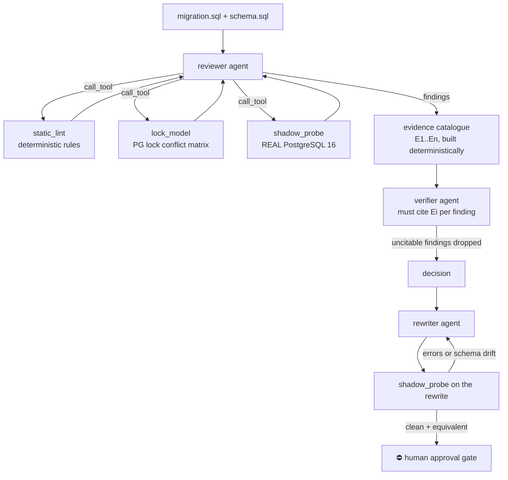

# Architecture

## The shape of the problem

Reviewing a schema migration is not a language task, it is a *state* task. The same
`ALTER TABLE` is harmless on an empty table and an outage on a 400-million-row one; the
same `VALIDATE CONSTRAINT` is textbook-correct or a failed deploy depending on data
nobody has looked at. A reviewer who only reads the SQL — human or model — is guessing.

So the design principle is one line: **the agent is not allowed to assert anything it
did not observe.** Everything else follows from that.

## Systems under comparison

| | `rules_only` (R0) | `baseline` (B0) | `advanced` (A) |
|---|---|---|---|
| model calls | 0 | 1 | 4–7 |
| tools | linter + lock matrix | none | linter, lock matrix, live PostgreSQL |
| grounding | rule id per finding | none | catalogued evidence id per finding, enforced |
| output | findings | findings | findings + a rewrite that was executed |

## Advanced pipeline

### 1. Reviewer agent — a real tool loop

The reviewer gets no pre-computed analysis. It is handed the migration, the schema, and
three tools, and it decides what to call. Each turn it emits one JSON action; the loop
executes the tool, appends the raw result to the transcript, and asks again. Unknown tool
names and malformed replies are fed back as errors rather than crashing the run, and both
the retry and its reason land in the trajectory.

The interesting tool is `shadow_probe`. It:

1. creates `mg_shadow_<random>` on a disposable cluster,
2. applies the project's schema and seeds every table with synthetic rows (FK-aware,
   parents before children),
3. runs the migration inside `BEGIN … ROLLBACK` with a savepoint per statement and reads
   `pg_locks` for that backend synchronously after each statement succeeds — locks are held
   to commit, so at that instant the set is exactly what has accumulated, which catches DDL
   that takes a millisecond and is deterministic (a polling sampler is not; see changelog
   A-8),
4. runs the migration again for real, per statement, with a `statement_timeout`, recording
   rows affected and the exact server error (durations are recorded for the trajectory but
   never shown to a model — see changelog A-8),
5. records `pg_class.relfilenode` before and after. A changed relfilenode is a *proof* of
   a whole-table rewrite; timing alone can never give that answer,
6. drops the database in a `finally` block.

### 2. Evidence catalogue — grounding as a mechanism, not a promise

Every observation any tool made is assigned a stable id (`E1`, `E2`, …) by
`evidence.py`, deterministically, before any model sees it. The verifier must cite ids
from that catalogue. `resolve()` keeps only ids that exist, so a fabricated citation
silently evaporates and the finding it was meant to support is dropped for lack of
support. Grounding is therefore a property of the data flow, not something a prompt asks
the model to please do.

### 3. Verifier agent

Sees the findings and the catalogue, nothing else. For each finding it returns the
supporting evidence ids and the severity the evidence justifies. Findings it cannot
support are dropped; findings it can are re-graded. A finding the verifier silently skips
is also dropped — silence is not support.

### 4. Rewriter agent, validated by execution

The rewriter proposes a safe version. That version is then *run* in a fresh shadow
database and compared with the original migration's end state (column set and index set).
A rewrite that errors, or that lands somewhere else, goes back to the model with the
server's own error text attached, once. If it still fails it is surfaced as
`NOT VALIDATED — do not trust` rather than presented as a fix. The CLI never hides that
distinction.

### 5. Human approval gate

`agents/approval.py` is the only code path that could touch a database MigrationGuard did
not create, and it refuses unless:

* the DSN appears in `MG_SANDBOX_DSNS` — production is never in that list, and
* a named human is recorded as the approver.

It then writes an approval record (case id, sha256 of the exact SQL, approver, timestamp,
host without credentials) and *still does not execute anything* — it hands the approved
file back to whatever migration runner the team already uses. The agent cannot call this;
it is a CLI verb a person runs.

## Determinism and replay

Every model call is content-addressed by `sha256(model + system_prompt + user_prompt)` and
written to `cassettes/`. `MG_LLM_PROVIDER=replay` serves those recordings, so the whole
benchmark reproduces offline, with no API key, at zero cost, to the same numbers. A
prompt change changes the hash, which turns "did you re-run this after editing the
prompt?" into a question the filesystem answers.

Temperature is 0. The shadow database is recreated per review, so nothing carries over
between cases.

## What is deliberately not here

* No production connectivity of any kind.
* No auto-apply, not even behind a flag.
* No vector store, no RAG, no fine-tuning — the useful context is a schema and a lock
  matrix, both of which fit in a prompt.
